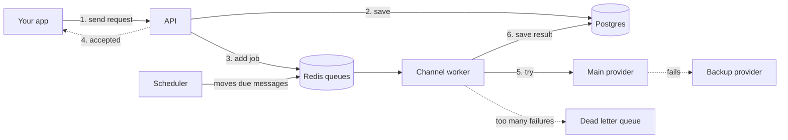

<div align="center">

# 🔔 Notification System

**Send email, SMS and push messages reliably, in the background.**


</div>

Other apps ask this service to send a message. It says **"accepted"** right away and sends the message in the background. If sending fails, it tries again, switches to a backup provider, or saves the message so nothing is lost.

---

## 📑 Contents

- [Tech used](#-tech-used)
- [What it can do](#-what-it-can-do)
- [How it works](#-how-it-works)
- [Monitoring with Prometheus](#-monitoring-with-prometheus)
- [Automatic checks with GitHub Actions](#-automatic-checks-with-github-actions)
- [How to run it](#-how-to-run-it)
- [Settings](#-settings)
- [Load test](#-load-test)
- [Project layout](#-project-layout)
- [More reading](#-more-reading)

---

## 🧰 Tech used

| Tool | What it is used for |
|:--|:--|
| **Python and FastAPI** | The main app that receives requests |
| **Postgres** | Stores users, templates, notifications and every delivery attempt |
| **Redis** | Holds the queues, rate limit counters, duplicate checks and delayed messages |
| **Prometheus** | Collects numbers (queue size, retries, failures) so you can watch the system's health |
| **Docker and Compose** | Starts the whole system with one command |
| **GitHub Actions** | Checks the code automatically on every push |
| **Mailhog** | A fake inbox, so you can see emails without sending real ones |
| **Locust** | Load testing, to see how much traffic the system can take |

---

## ✨ What it can do

| | Feature | In simple words |
|:--:|:--|:--|
| ⚡ | **Fast replies** | The caller gets an answer immediately and never waits for a slow provider. |
| 📨 | **Email, SMS and push** | Each channel has its own worker, so one slow channel does not stop the others. |
| 🔁 | **Retries** | A failed message is tried again. The wait grows each time, with a little randomness so retries do not all hit at once. |
| 📥 | **Dead letter queue** | A message that keeps failing is kept aside, not lost. An admin can send it again later. |
| 🚫 | **No duplicates** | The same request sent twice produces only one message. |
| 🌙 | **User preferences** | Users can turn off a channel and set quiet hours in their own time zone. Urgent messages, like login codes, ignore quiet hours. |
| 📝 | **Templates** | Write a message once with blanks. The system fills them in and never sends a half empty message. |
| 🥇 | **Priorities** | High, normal and low. Login codes go first, marketing goes last, and low priority still moves along. |
| 🛟 | **Backup provider** | If the main provider keeps failing, the backup takes over. The main one is tested again after a short rest. |
| ⏰ | **Scheduled messages** | Send a message at a time you choose. |
| 📦 | **Bulk sending** | Send one message to up to 100,000 users, split into small batches. You can check the progress. |
| 🚦 | **Rate limits** | Protects users from spam and providers from overload. |
| 🔎 | **Status tracking** | Every message has a status and a full history of attempts. |
| ✅ | **Delivery confirmation** | A provider can confirm a message reached the user, changing its status from sent to delivered. |
| 🛠️ | **Admin tools** | See how long each queue is and send failed messages again. |

**Statuses:** `queued` → `scheduled` → `sent` → `delivered`, or `failed` / `skipped`.

---

## ⚙️ How it works



### The parts

| Part | What it does |
|:--|:--|
| **API** | Receives the request, checks it, fills in the template, saves it in Postgres, adds a job to a Redis queue and replies at once. |
| **Queues** | Redis keeps a separate queue for each channel and priority. Scheduled messages and quiet hour messages wait in a delayed list until their time comes. |
| **Workers** | One each for email, SMS, push and bulk. They take jobs from the queue and deliver them. |
| **Scheduler** | Moves delayed messages onto the queue when due. Also rescues jobs left behind by a crashed worker. |

### What a worker does with each job

1. Checks the user's preferences and rate limit.
2. Checks the provider's rate limit.
3. Sends with the main provider.
4. If that fails, or the provider keeps failing, sends with the backup.
5. Saves the result and every attempt in Postgres.
6. On failure, puts the job back with a longer wait. After the last try it goes to the dead letter queue.

> 🛑 **Safe shutdown:** when a worker is stopped, it finishes the message it is working on first, then exits.

---

## 📊 Monitoring with Prometheus

The app and every worker share numbers in the Prometheus format. Connect Prometheus and a dashboard tool to watch:

| What | Why it helps |
|:--|:--|
| Notifications created | See how much traffic you get |
| Delivered and failed, per channel | Spot a broken channel |
| Retries | See how often providers are struggling |
| Dead lettered messages | Know when messages need attention |
| Queue length, per channel and priority | Know if workers are keeping up |
| Circuit breaker state | See if a provider is working, being tested or paused |

A health check also tells you if the database and Redis are working, and logs are written in a clear format so problems are easy to find.

---

## 🤖 Automatic checks with GitHub Actions

Every push to `master` and every pull request runs two checks:

| Check | What it does |
|:--|:--|
| **Lint** | Checks code style and common mistakes with Ruff |
| **Docker** | Builds the Docker image and checks the Compose file, so a broken setup is caught early |

---

## 🚀 How to run it

You only need Docker.

```bash
docker compose up --build
```

This starts the app, the email, SMS, push and bulk workers, the scheduler, Postgres, Redis and Mailhog.

| What | Address |
|:--|:--|
| Fake inbox (your emails show up here) | http://localhost:8025 |

> 💡 The SMS and push providers are fake. They fail 20% and 10% of the time on purpose, so you can see retries and the backup provider working.

<details>
<summary><b>Run without Docker</b></summary>

<br>

Start Postgres and Redis yourself, then run each part in its own terminal:

```bash
pip install -r requirements.txt
uvicorn app.main:app --reload
python -m app.workers.email_worker
python -m app.workers.sms_worker
python -m app.workers.push_worker
python -m app.workers.bulk_worker
python -m app.core.scheduler
```

</details>

---

## 🎛️ Settings

Settings are environment variables. The defaults work for local use, and all of them are in `app/config.py`.

| Setting | Default | What it does |
|:--|:--:|:--|
| `DATABASE_URL` | local Postgres | Where the database is |
| `REDIS_URL` | local Redis | Where Redis is |
| `MAX_ATTEMPTS` | 5 | Tries before the dead letter queue |
| `BACKOFF_BASE_SECONDS` | 2 | Starting wait between retries |
| `BACKOFF_CAP_SECONDS` | 300 | Longest wait between retries |
| `USER_RATE_CAPACITY` | 10 | Burst limit per user and channel |
| `BREAKER_FAILURE_THRESHOLD` | 5 | Failures before a provider is paused |
| `BREAKER_RECOVERY_SECONDS` | 30 | Pause time before testing the provider again |
| `SMS_FAILURE_RATE`, `PUSH_FAILURE_RATE` | 0 | How often the fake providers fail |
| `WORKER_CONCURRENCY` | 5 | Messages one worker handles at once |

---

## 🧪 Load test

```bash
pip install locust
locust -f loadtest/locustfile.py --host http://localhost:8000
```

Results are not recorded yet. Run it on your own setup and add the numbers here.

---

## 🗂️ Project layout

```
app/
├── api/         web routes
├── core/        queue, rate limiter, retry, circuit breaker, duplicate check, scheduler
├── providers/   email (SMTP), fake SMS and push, backups
├── services/    notification, bulk, preference and template logic
├── workers/     the programs that deliver messages
├── models/      database tables
└── schemas/     request and response shapes
loadtest/        load test scenarios
docs/            design document
```

---

## 📚 More reading

- [knowledge.md](knowledge.md): every feature in simple words
- [FEATURES.md](FEATURES.md): the feature checklist
- [docs/design.md](docs/design.md): the design, capacity estimate and trade offs
