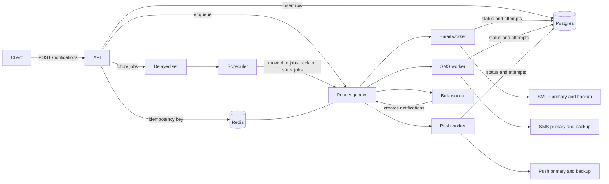

# Design Document

## 1. Requirements

### Functional
- Accept a notification request for a user on email, SMS or push, and answer immediately.
- Render content from a stored template and the request payload.
- Respect each user's channel opt in and quiet hours.
- Deliver through a provider, retry on failure, and fall back to a second provider.
- Never send the same request twice when a client retries.
- Let clients see the status and attempt history of every notification.
- Support priorities (OTP before marketing), scheduled sends, and bulk sends to many users.

### Non functional
- The API must stay fast and never wait on a provider. Accepting a request is one DB insert and one Redis push.
- Delivery is at least once. Duplicates are prevented by idempotency checks, not by exactly once delivery.
- A worker crash must not lose a job.
- A slow or failing provider must not stall the other channels.
- Components scale horizontally: more API replicas, more workers.

## 2. Capacity estimate

Assume 10 million notifications a day.

| Item | Estimate |
|---|---|
| Average rate | 10M / 86,400 s is about 115 per second |
| Peak rate | about 10x the average, so 1,000 to 1,200 per second |
| Postgres writes | 3 per notification (insert, status update, attempt row), so about 3,600 per second at peak |
| Row size | about 1 KB per notification including body and attempts |
| Storage | about 10 GB a day, so retention or partitioning by date is needed after a few weeks |
| Redis memory | a queued job is about 100 bytes, so a backlog of 1M jobs is about 100 MB |
| Workers | size from measured throughput per consumer (run the load test), then add consumers until the queue drains at peak |

A single Postgres and a single Redis are enough for this load. The write rate to Postgres is the first thing that grows.

## 3. Architecture

Redis holds the queues, delayed set, processing set, dead letter queues, rate limit buckets and idempotency keys. Postgres is the source of truth for users, templates, notifications and attempts.

## 4. Request flow

1. The client calls `POST /notifications` with an optional `Idempotency-Key`.
2. The API checks the user, template, address and payload, then renders the template.
3. If a key was sent, the API reserves it in Redis with `SET NX`. A repeat returns the original notification with the header `Idempotent-Replay: true`.
4. The API checks preferences. An opted out user gets a `skipped` record. Quiet hours move the send time to the end of the quiet window, except for high priority.
5. The row is saved, then the job goes to the queue for that channel and priority. A future send time goes to the delayed set instead. The API returns `202`.
6. A channel worker takes a job. Taking a job moves it into a processing set with a deadline, in one Lua script.
7. The worker checks the per user rate limit, then for each provider in order checks the provider rate limit and the circuit breaker, and sends.
8. Success sets the status to `sent`, or `delivered` when the provider confirms at once. Failure schedules a retry with backoff, or sends the job to the dead letter queue after the last attempt.
9. Every provider call is stored in `delivery_attempts`.

## 5. Key decisions and trade offs

**Redis lists instead of RabbitMQ or Kafka.** Redis is simple, fast and already needed for rate limits and idempotency. The cost is weaker durability than a broker and no built in replay. Kafka would fit much larger volume and event replay, but adds operational weight that this scale does not need.

**At least once delivery plus idempotency.** Exactly once across a network is not realistic. The worker skips notifications that already have a final status, and the API deduplicates requests by key. One gap remains: a crash after the provider accepted the message but before the status was saved can send twice. This is the usual trade off, and providers that accept a message id can close it.

**Postgres as the source of truth.** Redis can lose data on failure, so status and history live in Postgres. The queue only carries a notification id and an attempt number.

**Reliable queue pattern.** A job is moved to a processing sorted set with a deadline in the same Lua script that pops it. If the worker dies, the scheduler returns expired jobs to their queue. Nothing is lost between pop and acknowledge.

**Weighted priority polling.** A worker rotates which priority it checks first (5 high, 3 normal, 1 low), then falls through the rest. High priority gets most turns and low priority still moves, so marketing never starves.

**Equal jitter backoff.** The delay is half fixed and half random, capped at five minutes. This spreads retries so a recovering provider is not hit by everything at once.

**Token bucket in Lua.** Refill and take happen in one Redis call, so concurrent workers cannot overspend tokens. One bucket per user and channel, and one per provider.

**Circuit breaker per provider, held in worker memory.** After repeated failures a provider is skipped for a cooldown, then one probe call decides whether to close it. State is per worker process, so each worker learns on its own. Sharing it through Redis would converge faster but adds a Redis call to every send.

**Bulk sends as chunks.** A bulk request becomes jobs of 500 users on a dedicated queue. A bulk worker creates the individual notifications with a key made from the bulk id and user id, so a replayed chunk does not create duplicates. Progress is counted in `bulk_jobs`.

## 6. Failure scenarios

| Failure | What happens |
|---|---|
| Worker crashes mid send | The job stays in the processing set. After the visibility timeout the scheduler returns it to the queue. A status check prevents a second send when the first one finished. |
| Provider is down | Sends fail, the breaker opens after the threshold, and traffic goes to the backup provider. Failed jobs retry with backoff. |
| Every provider is down | Jobs retry up to the attempt limit, then go to the dead letter queue and the status becomes `failed`. `POST /admin/dlq/replay` puts them back. |
| Redis is down | The API returns errors on new requests. Rows already saved stay in Postgres. A request that was saved but never queued stays `queued` and needs a recovery job. Not built yet. |
| Postgres is down | The API cannot accept requests. Workers keep their jobs in the processing set and recover after the timeout. |
| Client retries a request | The idempotency key returns the original notification. A repeat that arrives before the first finished gets a 409. |
| Traffic spike | The API still answers fast and the queue grows. Add workers to drain it. Rate limits protect providers and users. |
| Worker stopped for a deploy | Consumers finish the job in hand, then exit. Anything unfinished is recovered by the scheduler. |

## 7. Scaling to 100x

At 1 billion a day the peak is around 100,000 sends per second. What changes:

- **Queue:** shard queues by key across several Redis instances, or move to Kafka partitions keyed by user id. This also gives ordering per user and replay.
- **Workers:** run hundreds of consumers, autoscaled on queue depth.
- **Database:** partition notifications and attempts by date, drop old partitions instead of deleting rows, add read replicas for status reads, and batch attempt inserts. Move old rows to cheap storage.
- **Status updates:** write attempt history asynchronously through the queue so the send path does less synchronous work.
- **Rate limits and breakers:** keep them in Redis so all workers share one view.
- **Providers:** more provider accounts, per region routing, and a healthier fallback order based on live success rate.
- **Multi region:** run a full stack per region and route users to their home region.
- **Fan out:** for very large bulk sends, resolve the audience in batches inside the bulk worker instead of in the API.
